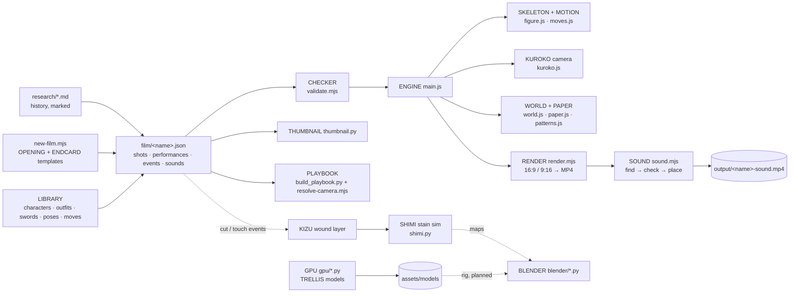

# SYSTEMS: everything in Paper Cinema, and how it connects

Every named system lives in one place, has one guide, and has one command. A machine-readable copy of this list
is in `systems.json` (same IDs). If you add a system, add it here **and** in `systems.json`.

## How the pieces connect (one film, start to finish)

One command runs the solid path: `node engine/make.mjs film/<name>.json` (check → stills → render → sound → playbook).

## The catalogue

| ID | System | What it does | Files | Guide | Command | Status |
|---|---|---|---|---|---|---|
| `STYLE` | **Lantern Origami** | The look: faceted washi paper lit from inside; amber = human, crimson = demonic; paint not blood | (rules) | `docs/STYLE-AND-FIGHT-SYSTEM.md` | | ✅ |
| `STRIKE` | **Strike Grammar** | Every attack in 6 beats: ready → wind-up → slash → hit-stop → follow-through → reaction | (rules) | `docs/STYLE-AND-FIGHT-SYSTEM.md` §2 | | ✅ |
| `FILM` | **Film file** | One JSON per film: shots, camera, performances, duels, events, shakes, titles, sounds, format | `film/*.json` | `docs/FILM-FORMAT.md` | | ✅ |
| `CHECK` | **Checker** | Validates a film and explains every mistake in plain words | `engine/validate.mjs` | `docs/FILM-FORMAT.md` | `npm run validate` | ✅ |
| `MAKE` | **One-command pipeline** | check → stills → render → sound → playbook | `engine/make.mjs` | `AGENTS.md` | `node engine/make.mjs film/x.json` | ✅ |
| `NEWFILM` | **New-film scaffolder** | Signature opening + fight body + end card, vertical by default | `engine/new-film.mjs`, `library/openings/`, `library/endcards/` | `docs/FILM-FORMAT.md` | `node engine/new-film.mjs x --jp 漢字 --en TITLE` | ✅ |
| `ENGINE` | **Preview engine** | Builds the 3D paper world per frame (`window.renderAt(t)`), deterministic | `engine/main.js`, `engine/index.html` | `AGENTS.md` | `npm run preview` | ✅ |
| `WORLD` | **Sets + paper** | Layered paper sea, island, coasts, sword studio; washi materials; 10 textile patterns | `engine/world.js`, `engine/paper.js`, `engine/patterns.js` | `docs/STYLE-AND-FIGHT-SYSTEM.md` | | ✅ (sets in code) |
| `SKELETON` | **Skeleton + balance** | Shared rig: two-part spine, neck, clavicles, shoulder/forearm twist, 2-axis wrists, ankles, optional glowing eyes with lids; leg IK, stance/crouch/weight, analytic arm IK (`solveArm`) | `engine/figure.js` | `docs/ANIMATION.md` | | ✅ |
| `MOTION` | **Motion system** | Keys of "second + pose", smooth monotone curves, breathing, cloth follow-through, walk cycle; anime layer: per-joint follow-through lag, `ease` snap curves, `settle` overshoot, `drag:0` contacts | `engine/figure.js`, `library/poses.json` | `docs/ANIMATION.md` | pose gallery: see guide §7 | ✅ |
| `MOVES` | **Fight moves** | Named moves (jump-back, parry, lunge-shomen, kesa-giri, tsuki, bind, dodge, stagger…) expanded into poses | `engine/moves.js`, `library/moves.json` | `docs/ANIMATION.md` §5b | | ✅ |
| `MOCAP` | **Motion capture from video** | Film a move with a phone → MediaPipe Pose Landmarker (Apache-2.0, CPU) per frame → left/right flip fix, zero-phase one-euro + Savitzky-Golay smoothing, ground contact → our channels (ry, waist/chest, shoulders + elbows by bounded IK fit, head, stance/crouch/weight, root travel, jumps) inside the joint limits → a performance key list (every frame, `--tol`, or `--keys N`) or a move (`--as-move`, relative fwd/side/turn); a film that replays it from where the phone stood; source/ours contact sheets; synthetic accuracy test on our own figure | `tools/mocap.py`, `tools/mocap_film.py`, `tools/mocap_sheet.py`, `tools/mocap_truth.mjs`, `tools/mocap_synth_test.py`, `film/mocap-test.json`, `film/mocap-synth.json`, `library/mocap/` | `docs/MOCAP.md` | `python3 tools/mocap.py clip.mp4 --out library/mocap/<name>.json --tol 0.05` | 🧪 v1 |
| `REACT` | **Reaction layer** | Fighters watch each other; delayed threat response (function react) | `engine/main.js` | `docs/ANIMATION.md` §6 | | ✅ |
| `DRAW` | **Sword draw** | One blade slides out of the scabbard into the grip, hand on the hilt | `engine/main.js` | `docs/ANIMATION.md` §5 | | ✅ |
| `KUROKO` | **KUROKO camera** | Automatic operator: rigs (frame/orbit/track/face/anchor/blade), feels (locked/dolly/crane/handheld/torpedo), motion-reactive behaviours, look-ahead, impact punch, guards | `engine/kuroko.js`, `engine/resolve-camera.mjs` | `docs/CAMERA.md` §7 | | ✅ |
| `KEYCAM` | **Keyframe camera** | Hand-made camera paths (pos/look/fov) on smooth curves + shakes | `engine/main.js` | `docs/CAMERA.md` §1–6 | | ✅ |
| `LIBRARY` | **Library** | Swords from parts, characters on one body, outfits, patterns | `library/`, `engine/library.js` | `library/*` + `docs/ANIMATION.md` | lineup: `engine/lineup.html` | ✅ |
| `RENDER` | **Renderer** | Headless Chrome, frame by frame → MP4; `--still`, `--vertical`, `--from/--to` | `engine/render.mjs`, `engine/serve.mjs` | `AGENTS.md` | `npm run render` | ✅ |
| `SOUND` | **Sound pipeline** | Find (Openverse) → check (ffmpeg) → place at cue times → mix; credits | `engine/sound.mjs`, `assets/sfx/` | `docs/playbook.html` | `npm run sound` | ✅ |
| `CLASH` | **Blade contact + hit-stop** | Finds blade-to-blade contact (segment distance, 240 Hz), clash aim so blocks meet the cut, hit-stop body time, sparks, smear ribbon, ink impact frame, auto sound cues (whoosh/clash/scrape) → `output/<film>.events.json` | `engine/motion.js`, `engine/motion.html`, `film/motion-test.json` | `docs/ANIMATION.md` | `node engine/render.mjs --film film/motion-test.json` | ✅ (motion page and main engine, via `engine/combat.js`) |
| `COMBAT` | **Combat layer (shared)** | The fight layer of both preview engines, in one module: blade contact detection (240 Hz segment distance, speed and gap thresholds), clash aim (`clashes`), hit-stop body time (`bodyT`/`filmT`; in `main.js` the shots, rigs and authored action times run on body time), smear ribbon, paper sparks + flash light, ink silhouette impact frame, camera punch, eye glow states + blinks + voice pulse (`cast.<id>.face: "eyes"`), auto sound cues (whoosh, steel clash or wood clap for a bokken, scrape) → `window.EVENTS` → `output/<film>.events.json` → SOUND; FX post stack (`fxBase`/`fx`) with a CA flash and bloom pulse on each contact | `engine/combat.js`, `engine/main.js`, `engine/motion.js`, `film/kuroko-duel.json` | `docs/FIX-LIST.md`, `docs/FILM-FORMAT.md` | `node engine/render.mjs --film film/kuroko-duel.json --vertical --still auto --prefix kd2-` | ✅ (main engine + motion page) |
| `AUDIT` | **Studio audit (automated QA)** | Runs on any film without drawing it: per-frame camera, joints on screen, lines of sight, foreground blockers, lens in geometry / under ground, pops, foot slide, blade teleports, smear, dead holds, 180° line, cut rhythm, slow-motion share, hook; pixel checks (black, burnt-out, flat); sound checks (hit has a transient, 9 dB over the whoosh, mush, loudness, stale mix). Scored report, exit 1 on a critical finding. Pages expose `window.AUDIT` through `engine/audit-hooks.js` | `tools/audit.mjs`, `engine/audit-hooks.js` | `docs/AUDIT.md`, `docs/STUDIO-STANDARD.md` | `node tools/audit.mjs film/x.json` | ✅ (motion page and main engine) |
| `STANDARD` | **Studio standard** | The rules every video must pass, taste + numbers; effects are light, characters are paper; beat → camera table; timing tables; the gate before a render | `docs/STUDIO-STANDARD.md` | `docs/STUDIO-STANDARD.md`, `docs/AUDIT-dash-test.md` | | ✅ |
| `GROUNDFX` | **Ground FX + afterimages** | From the motion alone: dash kick-up, wake line, skid spray, take-off and landing rings of sand, contact shadow pools, afterimages of light, and their sound cues (`dash-burst`, `skid-dust`, `jump-push`, `land-thud`) | `engine/groundfx.js` | `docs/STUDIO-STANDARD.md` §7 | | ✅ (motion page: on by default; main engine: opt-in `effects.ground`, `effects.contactShadow`) |
| `CINECAM` | **Cinematographer camera (motion page)** | `cameraOpts.solver: 2` (subject-relative spring, hard cuts, in-frame / ground / prop guards) + the `compose` framing solver (screen position, size, lead room, orbit, crane, push-in, dolly-zoom) + speed ramps `film.ramps` (film → world → body clocks) | `engine/motion.js`, `engine/combat.js`, `film/dash-test.json` | `docs/CAMERA.md` §8, `docs/STUDIO-STANDARD.md` §3–4 | `node engine/render.mjs --film film/dash-test.json --still 1.5,4.1` | ✅ (motion page) |
| `SYNTHSFX` | **Synthesised sword sounds** | Our own layered clash (tink + ring + body + paper crinkle), light clash, scrape, 3 whooshes, draw shing; no licence needed | `tools/synth_sfx.sh`, `assets/sfx/` | `docs/FIX-LIST.md` | `bash tools/synth_sfx.sh` | ✅ |
| `EARSHOT` | **Earshot sound bank (existing tool)** | 252 code-made sound effects (MIT, github.com/Leonxlnx/earshot), each whoosh aimed so its loudest moment lands on the blade's fastest frame; cues use `"earshot": "<id>"`, automatic whooshes via `autoSounds.whoosh.earshot` | `engine/sound.mjs` | `research/reference-videos.md` | `earshot sfx list` | ✅ |
| `AIROUTER` | **Free model router** | Sends writing, code, reasoning and image review to free models (Cerebras, NVIDIA Nemotron 550B / vision, Groq, Kimi), with fallback order and a usage log, so Claude usage goes to direction only | `tools/ai.py` | `docs/AI-ROUTER.md` | `python3 tools/ai.py list` | ✅ |
| `BLENDERSKILLS` | **Blender Skills pack (existing tool)** | 94 Blender skills for Claude Code (MIT, github.com/arjun988/blender-skills): camera-cinematography, animation, rigging, lighting, lookdev, materials, rendering, compositing, vfx-fx, cloth-sim, historical-worlds, qa-review… | `.claude/skills/`, `skills-lock.json` | `.claude/skills/<name>/SKILL.md` | (loaded automatically) | ✅ |
| `VOICE` | **Voice (spoken lines)** | Film `"voice"` lines → Kokoro-82M TTS (Apache-2.0, CPU) → cinematic chain (warmth, compression, hall, inner-monologue) → `output/<film>.voice.json`: cues mixed by SOUND with beds ducked 8 dB, plus 24 fps loudness envelopes to pulse the eyes | `tools/voice.py`, `engine/voice-env.js`, `assets/voice/`, `film/voice-test.json` | `docs/VOICE.md` | `nice -n 10 python3 tools/voice.py film/x.json` | ✅ (wired into main.js and motion.js via fxBase / fx) |
| `THUMB` | **Thumbnails** | 16:9 + 9:16 from the decisive-blow frame, kanji title, brush swash | `engine/thumbnail.py` | `AGENTS.md` | `python3 engine/thumbnail.py film/x.json` | ✅ |
| `PLAYBOOK` | **Playbook page** | Interactive page: pipeline, live camera plot, motion and sound timeline, new-chat prompt | `docs/playbook.template.html`, `docs/build_playbook.py` | `docs/playbook.html` | `npm run playbook` | ✅ |
| `SHIMI` | **SHIMI (染み) stain sim** | Paint soaking into paper: two water layers, fibres, saturation-limited wicking, gravity field, drips, tide lines; presets; data maps | `engine/shimi.py` | `docs/SHIMI.md`, `docs/SHIMI-3D.md` | `python3 engine/shimi.py --preset kesa-cut` | ✅ 2D · 3D planned |
| `KIZU` | **KIZU (傷) wound layer** | Decides how paint leaves a cut: onset delay, beads → line, depth/region welling, brush swipe, heavy-bead drips (non-graphic); option --wound | `engine/shimi.py` | `docs/SHIMI.md` §1c | `python3 engine/shimi.py --preset face-cut --out output/shimi/face-cut` | ✅ 2D |
| `LOOKDEV` | **Lookdev stages** | Sword materials (metal / demonic / ink) | `engine/lookdev.*` | `docs/BLENDER-PLAN.md` | | ✅ |
| `BLENDER` | **Blender (realistic)** | Headless Cycles renders; demon-slash test (cut paper, ink slash, paint) | `blender/*.py` | `docs/BLENDER-PLAN.md` | `blender -b -P blender/demon_slash_test.py -- --state impact` | 🧪 test |
| `BWORLD` | **Blender world set (Ganryūjima)** | Build-once 3D location: faceted paper island, pines, rocks, Ocean-modifier sea with foam, cut-paper mountain rings with sky haze, Nishita dawn + paper sun, paper clouds, optional fog; named collections, fighter marks (`MARK_*`) and camera anchors (`CAM_*`); seeded and deterministic | `blender/world/build_world.py` | `docs/BLENDER-WORLD.md` | `blender -b -P blender/world/build_world.py -- --out output/world/ganryujima.blend --preview output/world/preview.png` | 🧪 v1 |
| `PAPERMAT` | **Paper materials (Blender)** | Reusable Lantern Origami shaders: faceted washi (true-normal facets, fibre bump, per-facet tone, translucency, inner glow, stripes, sky haze), paper sea, metal | `blender/world/paper_materials.py` | `docs/BLENDER-WORLD.md` §3 | | 🧪 v1 |
| `SLASHFX` | **Slash effects (Blender)** | Keyframed crescent slash: tapered folded arc, emissive core (amber human / crimson demonic), ink-brush edge, paper-shard spray, flare light; radius, sweep, thickness, colour, demonic flag | `blender/world/slash_fx.py` | `docs/BLENDER-WORLD.md` §4 | `blender -b -P blender/world/slash_fx.py -- --test output/world/slash-test.png` | 🧪 v1 |
| `SETS` | **Sets (modular, data-driven, Blender)** | A location = one JSON in `library/sets/`: kit pieces with positions, sizes and seeds (ishigaki stone walls, plaster walls, kawara roofs, tenshu keep, yaguramon gate, floor planks, tatami, shoji, rooms, torii, toro lanterns, stairs, bridge, bamboo, pine, cherry, rocks, 2.5D paper-cut `layers` backdrops, fog, rain, petals/embers/dust, moon, the Ganryūjima island), lighting presets (night, dusk, dawn, day, overcast), fighter key/fill/rim, camera anchors `CAM_*`, marks `MARK_*`; realistic procedural stone, plaster, wood, tile, lacquer, washi materials; optional origami samurai on the marks in a pose; previews. Sets: castle-courtyard, dojo-interior, bamboo-forest, ganryujima-beach, castle-skyline-2d5 | `blender/sets/kit.py`, `blender/sets/build_set.py`, `library/sets/`, `blender/world/paper_materials.py`, `blender/character/origami_samurai.py` | `docs/SETS.md` | `blender -b -P blender/sets/build_set.py -- --set castle-courtyard --preview output/sets/castle.png --with-character hero:wide-stance,foe:hasso:demon` | 🧪 v1 |
| `POLYHAVEN` | **Poly Haven layer (CC0 photo textures + HDRI ambient)** | Search / download / cache CC0 Poly Haven textures (diffuse, normal GL, roughness, displacement, AO) and HDRIs, a role → asset manifest, a triplanar photo-detail layer mixed into the set materials (detail, tint, bump, roughness, AO; facets and washi fibre kept) and an HDRI lighting world (normalised and colour-matched to the procedural sky, sun clamped, camera still sees the procedural sky). On per set with `"polyhaven": true` | `tools/polyhaven.py`, `library/polyhaven.json`, `assets/polyhaven/CREDITS.md`, `blender/world/paper_materials.py`, `blender/sets/build_set.py` | `docs/SETS.md` §5b | `python3 tools/polyhaven.py sync` | 🧪 v1 |
| `CHARFACTORY` | **Modular origami character factory** | A character = one JSON recipe in `library/character-recipes/`: parts picked from a registry of folded paper pieces (kasa wide/narrow, hachigane, angular/long face masks with eye slits, hair and topknot, layered or plain kimono body with shoulder-to-sternum planes, crossed left-over-right lapels, obi with knot and cord, upper and hanging sleeves as separate folded bags, forearm and kote, folded-finger hands, TWO real pleated hakama legs, tabi+zori or war boots, sode and do lamellar plates, sheathed katana, tassels), each snapped to a socket on the shared humanoid rig (the same joint names as `engine/figure.js` and `rig_trellis.py`, so `library/poses.json` drives it), scaled inside an approved range, dressed from one washi material family with world-scale fibre, rigid parts parented to a bone and flexible ones skinned across 2-3 bones. Parts on paired sockets can swap independently by side. Blender film casts use these recipes and the resolved motion export. Skeletal FBX and a material manifest carry the bind pose into Unreal. `part_validator.py` gates the library: material, continuous grain UVs, scale, fibre, pivot, socket, self-intersection, solidify spikes, joint gaps across a five-pose sweep and silhouette readability | `blender/character/part_registry.py`, `blender/character/modular_builder.py`, `blender/character/part_validator.py`, `blender/character/export_character.py`, `library/character-recipes/`, `library/paper-materials/`, `blender/world/paper_materials.py` | `docs/CHARACTER-FACTORY.md` | `blender -b -P blender/character/modular_builder.py -- --recipe library/character-recipes/ronin-reference.json --turnaround output/character/t.png --light cinematic` | 🧪 v3 (six recipes and standalone kasa) |
| `BLENDERFILM` | **Blender film render** | The modular cast is selected through `library/character-models.json`. The film plays from world-space motion data: `tools/export_motion.mjs` writes what the preview engine really did per frame (joints, sword, camera, trees, events → `output/<film>.motion.json`); `rig_trellis.py` rigs any TRELLIS `.glb` (our joint names + a table to the standard humanoid names, bone-heat skin with scripted cleanup, relit paper, inner lantern, real-metal katana in a two-hand IK grip, sleeve follow-through) with three drivers: `library/poses.json`, film motion, BVH motion capture; `film_blender.py` renders it with dark cinematic light re-set per frame from the camera, the slash as swept light, dust, tree props, motion blur, and the film's camera or 12 named camera moves / a per-film plan | `tools/export_motion.mjs`, `blender/character/rig_trellis.py`, `blender/film_blender.py`, `library/blender-cameras.json` | `docs/CHARACTER-BLENDER.md` | `blender -b -P blender/film_blender.py -- --film film/dash-test.json --out output/blender/dash-test/ --times 0.3,1.15,4.2` | 🧪 v1 (stills; one fighter) |
| `STUDIOFILM` | **Studio film production** | A scene file sets the modular cast, pose keys, planted feet, paper follow-through, studio or set, tracked focus, camera cuts and sound. Bakes the editable Blender project, framing and contact audit and the MP4. | `blender/studio_film.py`, `film/studio/paper-awakens.json`, `engine/sound.mjs` | `docs/STUDIO-FILM.md` | `blender -b -P blender/studio_film.py -- --scene film/studio/paper-awakens.json --out output/paper-awakens` | ✅ |
| `GPU` | **GPU jobs** | Rent/run/stop RunPod pods (self-destruct timer); TRELLIS image → 3D | `gpu/*.py` | `AGENTS.md` rules | `python3 gpu/pod.py status` | ✅ (paid: ask first) |
| `MODELS` | **3D character catalog** | Seven TRELLIS source GLBs map to rigged character recipes or the kasa part. The modular catalogue shot uses the same recipes locally and on Kaggle. | `assets/models/`, `library/character-models.json`, `blender/character/character_shot.py` | `assets/README.md` | | ✅ Blender and FBX |
| `ANATOMY` | **Anatomy (third-party skill)** | Interactive isometric explainer figures (SVG/WebGL), for example "anatomy of a katana" Shorts; MIT, by wheresryan22 | `.claude/skills/anatomy/SKILL.md` | `.claude/skills/anatomy/SKILL.md` | `/anatomy explain how a katana is built` | ✅ installed |
| `STORY` | **Story bible** | World rules, characters, cursed swords (fiction), episode ideas | `docs/STORY-BIBLE.md` | | | ✅ |
| `SCENE` | **Scene writing** | Idea → logline → beat sheet (1 s hook, jo-ha-kyū) → voiced lines with timing and direction → moves, shot types, sounds, effects → film-JSON outline; 9 reusable templates, taste rules, checklist | `.claude/skills/scene-writing/SKILL.md`, `library/scene-templates.json` | `docs/SCENE-WRITING.md` | | ✅ |
| `DIRECTION` | **Scene direction** | Story beat → shot list → KUROKO rigs / motion-page camera beats → lighting mood → cut rhythm → taste review; 49 named shots (tested in 9:16 and 16:9), 17 direction styles (Kurosawa, Leone, Kubrick, Wong Kar-wai, Deakins, Spielberg, ufotable, MAPPA, Sword of the Stranger, Champloo, Shinkai, Kon, Itano, Arcane, Hong Kong, John Wick, dark monologue), 11 lighting moods, a fight-beat map | `.claude/skills/scene-direction/SKILL.md`, `library/shots.json` | `docs/DIRECTION.md` | | ✅ |
| `RESEARCH` | **Research** | History with confidence marks | `research/` | | | ✅ |
| `EFFECTS` | **Effects plan** | Face-touch scene, slash v2, anime effects (flash-step, shadow-vanish, speed lines, impact frame) | `docs/EFFECTS-PLAN.md` | | | 📋 planned |
| `FX` | **FX post-processing (three.js preview)** | Deterministic effect stack any page can import: bloom (UnrealBloomPass), one lens pass (colour-grade moods, vignette, film grain, letterbox, chromatic-aberration flash, radial speed lines, ink impact frame, flash/fade), light-shaft cards, seeded particles (dust/ember/petal/snow/ash/shard), glint "ping", trauma shake; `fxAt()` turns film `fx` events into per-frame params; catalogue of 42 effects in `library/effects.json` | `engine/fx.js`, `engine/fx-demo.html`, `engine/fx-demo.js`, `film/fx-demo.json`, `library/effects.json` | `docs/EFFECTS-CATALOG.md` | `node engine/render.mjs --page engine/fx-demo.html --film film/fx-demo.json --still 3.7,13.7 --prefix fx-` | 🧪 demo page (wired into main.js and motion.js) |

Legend: ✅ built and used · 🧪 working test · 📋 designed, not built.

## Where to put new things
- **A new pose:** `library/poses.json`. **A new move:** `library/moves.json`.
- **A new sword, character or outfit:** `library/swords/`, `library/characters/` or `library/outfits/`.
- **A new film:** `node engine/new-film.mjs <name> …`, which creates `film/<name>.json`.
- **A new named shot or direction style:** `library/shots.json` (test it with stills; guide `docs/DIRECTION.md`).
- **A new camera rig or behaviour:** `engine/kuroko.js` (export it in `RIG_TYPES` / `BEHAVIOURS` so the checker knows it).
- **A new SHIMI scenario:** add to `PRESETS` in `engine/shimi.py`.
- **A new system:** add a row here and in `systems.json`, a guide in `docs/`, and a line in `AGENTS.md` if it changes the rules.
- **Generated files** (videos, frames, stills) go to `output/`, which is not committed.
