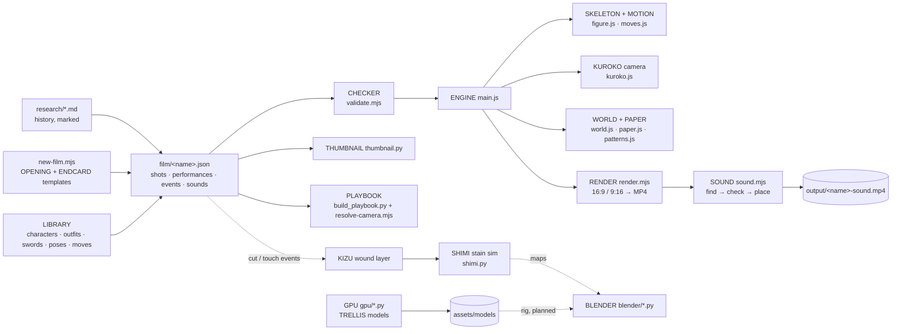

# SYSTEMS: everything in Paper Cinema, and how it connects

Every named system lives in one place, has one guide, and has one command. A machine-readable copy of this list
is in `systems.json` (same IDs). If you add a system, add it here **and** in `systems.json`.

## How the pieces connect (one film, start to finish)

One command runs the solid path: `node engine/make.mjs film/<name>.json` (check → stills → render → sound → playbook).

## The catalogue

| ID | System | What it does | Files | Guide | Command | Status |
|---|---|---|---|---|---|---|
| `STYLE` | **Lantern Origami** | The look: faceted washi paper lit from inside; amber = human, crimson = demonic; paint not blood | (rules) | `docs/STYLE-AND-FIGHT-SYSTEM.md` | | ✅ |
| `STRIKE` | **Strike Grammar** | Every attack in 6 beats: ready → wind-up → slash → hit-stop → follow-through → reaction | (rules) | `docs/STYLE-AND-FIGHT-SYSTEM.md` §2 | | ✅ |
| `FILM` | **Film file** | One JSON per film: shots, camera, performances, duels, events, shakes, titles, sounds, format | `film/*.json` | `docs/FILM-FORMAT.md` | | ✅ |
| `CHECK` | **Checker** | Validates a film and explains every mistake in plain words | `engine/validate.mjs` | `docs/FILM-FORMAT.md` | `npm run validate` | ✅ |
| `MAKE` | **One-command pipeline** | check → stills → render → sound → playbook | `engine/make.mjs` | `AGENTS.md` | `node engine/make.mjs film/x.json` | ✅ |
| `NEWFILM` | **New-film scaffolder** | Signature opening + fight body + end card, vertical by default | `engine/new-film.mjs`, `library/openings/`, `library/endcards/` | `docs/FILM-FORMAT.md` | `node engine/new-film.mjs x --jp 漢字 --en TITLE` | ✅ |
| `ENGINE` | **Preview engine** | Builds the 3D paper world per frame (`window.renderAt(t)`), deterministic | `engine/main.js`, `engine/index.html` | `AGENTS.md` | `npm run preview` | ✅ |
| `WORLD` | **Sets + paper** | Layered paper sea, island, coasts, sword studio; washi materials; 10 textile patterns | `engine/world.js`, `engine/paper.js`, `engine/patterns.js` | `docs/STYLE-AND-FIGHT-SYSTEM.md` | | ✅ (sets in code) |
| `SKELETON` | **Skeleton + balance** | Shared rig with legs: leg IK (planted feet, bending knees), stance/crouch/weight, two-hand grip, hand reach | `engine/figure.js` | `docs/ANIMATION.md` | | ✅ |
| `MOTION` | **Motion system** | Keys of "second + pose", smooth monotone curves, breathing, cloth follow-through, walk cycle | `engine/figure.js`, `library/poses.json` | `docs/ANIMATION.md` | pose gallery: see guide §7 | ✅ |
| `MOVES` | **Fight moves** | Named moves (jump-back, parry, lunge-shomen, kesa-giri, tsuki, bind, dodge, stagger…) expanded into poses | `engine/moves.js`, `library/moves.json` | `docs/ANIMATION.md` §5b | | ✅ |
| `REACT` | **Reaction layer** | Fighters watch each other; delayed threat response (function react) | `engine/main.js` | `docs/ANIMATION.md` §6 | | ✅ |
| `DRAW` | **Sword draw** | One blade slides out of the scabbard into the grip, hand on the hilt | `engine/main.js` | `docs/ANIMATION.md` §5 | | ✅ |
| `KUROKO` | **KUROKO camera** | Automatic operator: rigs (frame/orbit/track/face/anchor/blade), feels (locked/dolly/crane/handheld/torpedo), motion-reactive behaviours, look-ahead, impact punch, guards | `engine/kuroko.js`, `engine/resolve-camera.mjs` | `docs/CAMERA.md` §7 | | ✅ |
| `KEYCAM` | **Keyframe camera** | Hand-made camera paths (pos/look/fov) on smooth curves + shakes | `engine/main.js` | `docs/CAMERA.md` §1–6 | | ✅ |
| `LIBRARY` | **Library** | Swords from parts, characters on one body, outfits, patterns | `library/`, `engine/library.js` | `library/*` + `docs/ANIMATION.md` | lineup: `engine/lineup.html` | ✅ |
| `RENDER` | **Renderer** | Headless Chrome, frame by frame → MP4; `--still`, `--vertical`, `--from/--to` | `engine/render.mjs`, `engine/serve.mjs` | `AGENTS.md` | `npm run render` | ✅ |
| `SOUND` | **Sound pipeline** | Find (Openverse) → check (ffmpeg) → place at cue times → mix; credits | `engine/sound.mjs`, `assets/sfx/` | `docs/playbook.html` | `npm run sound` | ✅ |
| `THUMB` | **Thumbnails** | 16:9 + 9:16 from the decisive-blow frame, kanji title, brush swash | `engine/thumbnail.py` | `AGENTS.md` | `python3 engine/thumbnail.py film/x.json` | ✅ |
| `PLAYBOOK` | **Playbook page** | Interactive page: pipeline, live camera plot, motion and sound timeline, new-chat prompt | `docs/playbook.template.html`, `docs/build_playbook.py` | `docs/playbook.html` | `npm run playbook` | ✅ |
| `SHIMI` | **SHIMI (染み) stain sim** | Paint soaking into paper: two water layers, fibres, saturation-limited wicking, gravity field, drips, tide lines; presets; data maps | `engine/shimi.py` | `docs/SHIMI.md`, `docs/SHIMI-3D.md` | `python3 engine/shimi.py --preset kesa-cut` | ✅ 2D · 3D planned |
| `KIZU` | **KIZU (傷) wound layer** | Decides how paint leaves a cut: onset delay, beads → line, depth/region welling, brush swipe, heavy-bead drips (non-graphic); option --wound | `engine/shimi.py` | `docs/SHIMI.md` §1c | `python3 engine/shimi.py --preset face-cut --out output/shimi/face-cut` | ✅ 2D |
| `LOOKDEV` | **Lookdev stages** | Sword materials (metal / demonic / ink) | `engine/lookdev.*` | `docs/BLENDER-PLAN.md` | | ✅ |
| `BLENDER` | **Blender (realistic)** | Headless Cycles renders; demon-slash test (cut paper, ink slash, paint) | `blender/*.py` | `docs/BLENDER-PLAN.md` | `blender -b -P blender/demon_slash_test.py -- --state impact` | 🧪 test |
| `GPU` | **GPU jobs** | Rent/run/stop RunPod pods (self-destruct timer); TRELLIS image → 3D | `gpu/*.py` | `AGENTS.md` rules | `python3 gpu/pod.py status` | ✅ (paid: ask first) |
| `MODELS` | **3D models** | 5 models from reference images (TRELLIS, MIT) | `assets/models/` | `assets/README.md` | | ✅ static (no rig yet) |
| `STORY` | **Story bible** | World rules, characters, cursed swords (fiction), episode ideas | `docs/STORY-BIBLE.md` | | | ✅ |
| `RESEARCH` | **Research** | History with confidence marks | `research/` | | | ✅ |
| `EFFECTS` | **Effects plan** | Face-touch scene, slash v2, anime effects (flash-step, shadow-vanish, speed lines, impact frame) | `docs/EFFECTS-PLAN.md` | | | 📋 planned |

Legend: ✅ built and used · 🧪 working test · 📋 designed, not built.

## Where to put new things
- **A new pose:** `library/poses.json`. **A new move:** `library/moves.json`.
- **A new sword, character or outfit:** `library/swords/`, `library/characters/` or `library/outfits/`.
- **A new film:** `node engine/new-film.mjs <name> …`, which creates `film/<name>.json`.
- **A new camera rig or behaviour:** `engine/kuroko.js` (export it in `RIG_TYPES` / `BEHAVIOURS` so the checker knows it).
- **A new SHIMI scenario:** add to `PRESETS` in `engine/shimi.py`.
- **A new system:** add a row here and in `systems.json`, a guide in `docs/`, and a line in `AGENTS.md` if it changes the rules.
- **Generated files** (videos, frames, stills) go to `output/`, which is not committed.
