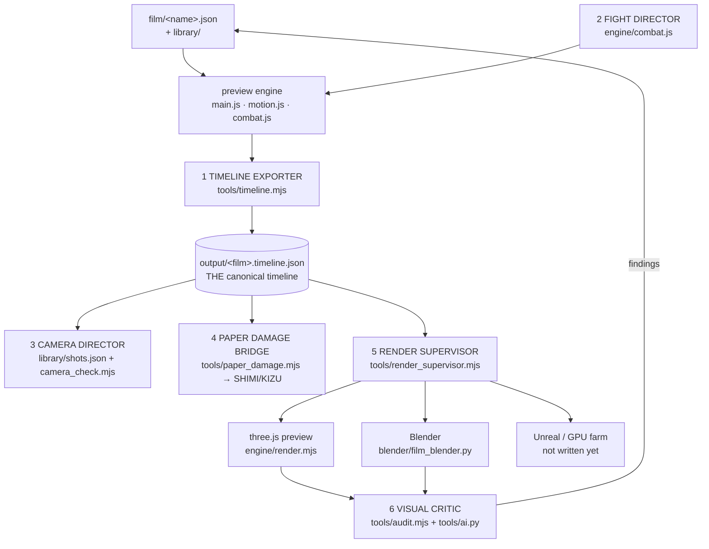

# ARCHITECTURE: one timeline, six modules

Paper Cinema is **data + six modules around one canonical timeline**. This is the map: what each module is called,
what it must do, which code does it today, and what is still missing. It is the shape the owner's research plan asks
for, so the day a GPU machine (or Unreal) exists, nothing has to be re-thought — only a new reader of the timeline
has to be written.



**The rule that holds it together:** every module reads the timeline and nothing else. A module never re-detects a
fact another module already established — one verified event drives contact, sound, camera, damage and the critic
(`docs/TIMELINE-FORMAT.md` §10).

---

## 1. Timeline Exporter — `tools/timeline.mjs`
**Does:** opens the film's own page in headless Chrome, poses every frame, and writes the one interchange format:
per-frame bone transforms (root motion included), the weapon at sub-frame resolution, the camera (position,
rotation, focal length, focus distance), shots and cut frames, events with stable ids, lights, effect parameters,
asset references, the coordinate convention, and a **backward-scrub check** that proves the engine is a pure
function of time.
**Code:** `tools/timeline.mjs` · format `docs/TIMELINE-FORMAT.md` · the old single-purpose exporter
`tools/export_motion.mjs` is kept for the Blender legacy path and is now a subset of this.
**Covers:** motion-page films (camera beats) and the shots-based main engine (`ganryujima`, `kuroko-duel`); gallery
pages without a cast export camera + metadata.
**Gap:** actor animation is always `sampled` (no clip references yet); a tool that converts the timeline to glTF /
USD / Unreal Level Sequence is the next reader to write — the conversion belongs in `coords` (§3 of the format), not
in the reader.

## 2. Fight Director — `engine/combat.js`
**Does:** the plan's fight pipeline, in order: **position** the fighters within weapon reach, **sync** the
defender's reaction to the contact time, **correct** the weapon path by IK (the clash aim turns the defender's wrist
so the blades actually meet), **verify** the blade trajectories at sub-frame resolution (240 Hz, no tunnelling, no
teleporting tip), and emit **ONE verified event** per strike that drives contact + sound + camera punch + damage.
**Code:** `engine/combat.js` — `clashAim()` (the IK correction), `analyse()` (240 Hz contact detection, hit-stop,
automatic sound cues, ribbon, sparks, ink frame) and `direct()` (the verification pass: reach, reaction timing, aim
residual, sub-frame tunnelling → `strikes[]` + findings). `window.EVENTS.strikes` carries the verified events into
the timeline as `blade-contact.NN`.
**Gap:** `direct()` measures and reports; it does not yet *move* a fighter into reach or add the missing reaction
key by itself (it says by how much and where). Doing that automatically is the next step, and it must stay
reviewable: the engine writes keys, a human looks at the stills.

## 3. Camera Director — `library/shots.json` + `tools/camera_check.mjs`
**Does:** chooses the shot (49 named shots, 17 direction styles, a beat → camera map, lighting moods), then
**scores** what the camera actually did: subject / weapon / target visibility and occlusion, action clarity on the
strike frame, framing size against the size the shot asked for, continuity (the 180° line, the 30° rule), timing
against the verified events, camera motion (smooth, not a whip without a cut, clear of geometry) and emotional fit
per beat. A failure is **rejected with its reason** ("the orbit camera passes through geometry 0.18 m from the lens
during the strike at f112") and the nearest passing alternative from `library/shots.json` is proposed.
**Code:** data `library/shots.json` · the operator `engine/kuroko.js` (rigs, feels, behaviours) and the motion-page
`compose` solver (`engine/motion.js`) · the evaluator `tools/camera_check.mjs`, which is also the **camera section
of the studio audit** (`tools/audit.mjs` imports it, so the two can never disagree) and a required step of the
`scene-direction` skill · guides `docs/CAMERA.md`, `docs/DIRECTION.md`.
**Gap:** the proposal is ranked from the library's *measured* numbers, not by re-rendering the alternative. A
"propose and prove" mode (render the alternative's stills and re-score) is the obvious next step.

## 4. Paper Damage Bridge — `tools/paper_damage.mjs` → SHIMI / KIZU
**Does:** turns a cut in the film into the event every renderer needs to put paint on paper: which part, when, the
UV window and texel size for that shot size, the gravity field, the planned wound polyline, and the KIZU wound
behaviour (onset, depth, drips — paint, never blood). The contract is written in `docs/SHIMI-3D.md` §2 and is the
same for Blender (`paper_mat_shimi`) and the three.js preview.
**Code:** `tools/paper_damage.mjs` (the bridge and the event contract) · the simulation `engine/shimi.py` (SHIMI 2D +
the KIZU wound layer) · design `docs/SHIMI-3D.md`, `docs/SHIMI.md`.
**Gap (named in the tool):** the polyline is **planned** from the blade sweep, not measured on the mesh. The real UV
sweep needs the `shimi` UV layer and the mesh cut (`bmesh.ops.bisect_plane`): SHIMI-3D milestone 2. Every record
carries `polyline.source: "planned"` and `stub: true`, so no renderer can mistake it for a measurement.

## 5. Render Supervisor — `tools/render_supervisor.mjs`
**Does:** reads the timeline's shot list and renders **shot by shot**, with one quality-preset table for every
renderer (`draft` / `preview` / `final` / `hero`), retries, per-shot failure isolation, and **resume**: the state of
every shot (its frame hash) lives in `output/<film>.render-state.json`, so a killed 55-minute render picks up where
it stopped and a timeline change re-renders only the shots whose frames changed.
**Code:** `tools/render_supervisor.mjs` · the renderers it drives: `engine/render.mjs` (three.js preview, MP4),
`blender/film_blender.py` (Cycles) · `engine/make.mjs` is the one-command pipeline around it.
**Gap:** no distributed queue (RunPod / Kaggle) and no sound/assembly step yet: it produces frames per shot;
`engine/make.mjs` still assembles the film. AGENTS.md rule 1 (paid GPUs: ask first) applies to any farm backend.

## 6. Visual Critic — `tools/audit.mjs` + `tools/ai.py`
**Does:** judges the result against the studio standard without a human: per-frame geometry and staging, pops, foot
slide, smear, dead holds, cut rhythm, pixels (black / burnt-out / flat), the sound mix, **the camera section**
(module 3), and a scored report that exits 1 on a critical finding. What a number cannot judge (idea, silhouette,
line of action, taste) goes to a free vision model (`tools/ai.py review`) and to a Fable review of the stills
(AGENTS.md rules 01, 02).
**Code:** `tools/audit.mjs`, `engine/audit-hooks.js` (what a page exposes), `tools/camera_check.mjs` (camera
section), `tools/ai.py` (vision review) · guides `docs/AUDIT.md`, `docs/STUDIO-STANDARD.md`.
**Gap:** the critic reads rendered frames and engine measurements, not the timeline, so it still needs a browser. A
timeline-only pass (geometry findings without rendering) would make it usable inside a render farm.

---

## Where a change goes
| You want to… | Touch |
|---|---|
| add a fact every renderer needs | `tools/timeline.mjs` + `docs/TIMELINE-FORMAT.md` (add a field; never rename one) |
| change how a hit is found or verified | `engine/combat.js` (`analyse`, `direct`) — never a renderer |
| add a shot or a rig | `library/shots.json`, `engine/kuroko.js`; then score it with `tools/camera_check.mjs` |
| change what makes a camera good | `tools/camera_check.mjs` (`CRULE`) + `docs/STUDIO-STANDARD.md` |
| change how paint leaves a cut | `engine/shimi.py` (KIZU) + the contract in `tools/paper_damage.mjs` |
| add a renderer | a reader of the timeline + a case in `tools/render_supervisor.mjs`; nothing else |
| add a quality level | `QUALITY` in `tools/render_supervisor.mjs` (one table, every renderer) |

## The order of a day's work
```bash
node engine/validate.mjs film/x.json            # 1. the film file is legal
node tools/timeline.mjs film/x.json             # 2. the canonical timeline (+ the backward-scrub check)
node tools/camera_check.mjs film/x.json         # 3. the camera is defensible (exit 1 = a shot is rejected)
node tools/paper_damage.mjs film/x.json         # 4. every cut has a wound contract
node tools/audit.mjs film/x.json                # 5. the studio audit (camera section included)
node tools/render_supervisor.mjs film/x.json --plan   # 6. the shot plan, then render it
```
